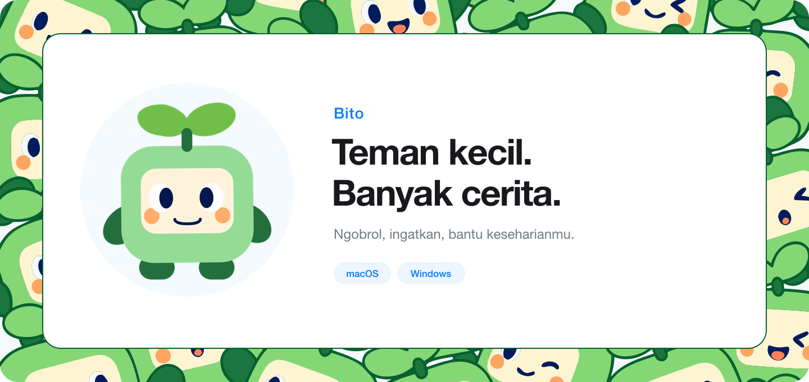

<p align="center">
  
</p>

<h1 align="center">Bito</h1>
<p align="center"><strong>Teman kecil untuk berpikir, merencanakan, dan mulai mengerjakan.</strong><br />Ngobrol, susun tugas, dan dapatkan bantuan saat bekerja—langsung di desktopmu.</p>
<p align="center">
  <a href="https://github.com/feboyfierlyan/bito-desktop/releases/latest"><strong>Unduh Bito v0.6.3 · Latest</strong></a> ·
  <a href="#apa-yang-bisa-kamu-lakukan">Jelajahi fitur</a> ·
  <a href="#mulai-dengan-bito">Cara mulai</a> ·
  <a href="CHANGELOG.md">Yang baru</a>
</p>
<p align="center">macOS & Windows · Companion AI dengan workspace proyek</p>

Bito menemani kamu dari “mulai dari mana?” sampai langkah berikutnya terasa jelas. Ceritakan tugasmu, sertakan bahan yang relevan, lalu susun rencana yang bisa kamu ubah sendiri. Saat butuh bantuan, Bito tetap dekat sebagai karakter kecil yang bisa dipindahkan di desktop.

## Unduh Bito

**[v0.6.3 adalah rilis Latest](https://github.com/feboyfierlyan/bito-desktop/releases/latest)**, tersedia sebagai rilis biasa di GitHub Releases.

| Perangkat | Unduhan v0.6.3 |
| --- | --- |
| Mac Apple Silicon · M1 atau lebih baru | [DMG](https://github.com/feboyfierlyan/bito-desktop/releases/download/v0.6.3/Bito-0.6.3-macOS-arm64.dmg) · [ZIP](https://github.com/feboyfierlyan/bito-desktop/releases/download/v0.6.3/Bito-0.6.3-macOS-arm64.zip) |
| Mac Intel | [DMG](https://github.com/feboyfierlyan/bito-desktop/releases/download/v0.6.3/Bito-0.6.3-macOS-x64.dmg) · [ZIP](https://github.com/feboyfierlyan/bito-desktop/releases/download/v0.6.3/Bito-0.6.3-macOS-x64.zip) |
| Windows x64 | [Installer EXE](https://github.com/feboyfierlyan/bito-desktop/releases/download/v0.6.3/Bito-0.6.3-Windows-x64-Setup.exe) |

[Panduan instalasi](docs/INSTALL.md) · [Catatan rilis v0.6.3](docs/releases/v0.6.3.md) · [Checksum SHA-256](https://github.com/feboyfierlyan/bito-desktop/releases/download/v0.6.3/SHA256SUMS.txt) · [Semua versi](https://github.com/feboyfierlyan/bito-desktop/releases)

**Sebelum mengunduh:** installer tersedia publik, tetapi login dan layanan AI masih memerlukan akun Google yang diizinkan oleh pengelola Bito. macOS belum memiliki Developer ID/notarization dan installer Windows belum signed; peringatan keamanan OS mungkin muncul. Lihat [batasan rilis](#batasan-rilis) sebelum memasang.

## Apa yang bisa kamu lakukan

### Dari ide menjadi langkah yang bisa dikerjakan

Buat proyek dari penjelasan tugas dan bahan pendukungmu. Bito membantu menyusun kelompok tugas, langkah, dan tanggal. Kamu bisa menambah kelompok, mengedit tugas, mengatur tenggat, atau mengubah rencana setelah dibuat. Daftar tugas, kalender, dan progres berada dalam satu workspace agar konteksnya mudah diikuti.

### Ngobrol tanpa kehilangan konteks

Pilih obrolan umum atau kaitkan percakapan dengan proyek yang sedang kamu kerjakan. Bito punya empat gaya bicara: **To the point**, **Chill**, **Humoris**, dan **Care**. Lampirkan gambar, PDF, atau file teks, periksa pratinjaunya, lalu tulis pertanyaanmu. Lampiran chat baru dianalisis setelah kamu menekan **Kirim**.

### Tanya tentang yang ada di layar

Pilih **Tanya area layar**, tandai bagian yang ingin dibahas, lalu tambahkan pertanyaan. Cuplikan menjadi lampiran untuk pesan tersebut dan tidak otomatis dipakai kembali pada pesan berikutnya. Untuk bantuan langkah demi langkah, Bito dapat menampilkan petunjuk dan sorotan layar; kamu tetap yang menjalankan tindakannya.

### Jaga rencana tetap dekat

Gunakan checklist, pengingat, dan timer untuk langkah kecil sehari-hari. Hubungkan Google Calendar untuk mengirim jadwal rencana yang kamu setujui. Bito juga dapat membantu mencari informasi dengan sumber serta membuat file teks seperti Markdown atau CSV yang kamu simpan ke lokasi pilihanmu.

### Hadir secukupnya

Bito berukuran default **180px**, dengan chat ringkas dan kontrol yang muncul saat dibutuhkan. Seret karakter ke posisi yang nyaman, klik untuk ngobrol, atau aktifkan **Jangan Ganggu** saat ingin fokus. Perpindahan dari onboarding ke desktop dan perubahan bentuk kontrol memakai animasi yang menyambung.

## Mulai dengan Bito

1. **Pasang aplikasi untuk perangkatmu.** Di Mac, buka DMG dan seret Bito ke Applications. Di Windows, jalankan installer EXE.
2. **Masuk dan kenalan.** Gunakan akun Google yang sudah mendapat akses, isi nama panggilan, lalu pilih gaya bicara. Kamu tidak perlu memasukkan API key sendiri.
3. **Bawa Bito ke desktop.** Seret karakter dari langkah terakhir onboarding. Klik untuk chat, atau buka Proyek untuk mulai menyusun pekerjaanmu.

Untuk memperbarui aplikasi, keluar dari Bito lalu pasang versi baru. Jangan hapus data aplikasi jika ingin mempertahankan riwayat. Pembaruan otomatis belum tersedia; petunjuk lengkap ada di [panduan instalasi](docs/INSTALL.md).

## Kamu tetap punya kendali

- **Data lokal per akun.** Profil, riwayat chat, proyek, tugas, dan pengingat disimpan di perangkat. Kelola memori, hapus chat, atau ekspor data lewat Pengaturan.
- **AI menggunakan layanan online.** Pesan, konteks percakapan yang relevan, dan lampiran yang dikirim diproses oleh layanan backend/AI. Penyimpanan lokal bukan berarti seluruh pemrosesan berlangsung offline.
- **Bantuan layar atas permintaanmu.** Chat biasa tidak mengizinkan model mengambil tangkapan layar. Fitur bantuan layar memakai cuplikan dan konteks yang diperlukan selama permintaan atau sesi panduan aktif, dengan izin OS yang sesuai.
- **Tindakan tetap di tanganmu.** Bito memberi petunjuk; ia tidak mengklik atau mengetik ke aplikasi lain untukmu. Akses file berasal dari file yang kamu pilih atau lampirkan.

## Batasan rilis

v0.6.3 ditandai sebagai **Latest** di GitHub. Status ini tidak menghilangkan batasan berikut:

- **Penandatanganan:** paket Mac memakai tanda tangan ad-hoc, belum Developer ID dan notarization Apple. Installer Windows belum memiliki tanda tangan penerbit.
- **Akses akun:** layanan backend masih dibatasi untuk akun yang diizinkan. Akun Google Calendar dalam mode OAuth Testing mungkin juga perlu terdaftar sebagai test user.
- **Calendar:** sinkronisasi satu arah, dari Bito ke Google Calendar, dan berjalan saat Bito terbuka. Pengingat lokal juga membutuhkan aplikasi tetap berjalan.
- **Cakupan pengujian:** build dan tes CI macOS/Windows telah lolos. Interaksi native serta instalasi/upgrade Windows dan Mac Intel belum seluruhnya diuji langsung pada perangkat fisik. Login Google baru di setiap platform juga belum terverifikasi end-to-end; tes integrasi live memakai akun yang sudah terhubung.
- **Koneksi dan hasil AI:** fitur AI serta bantuan layar memerlukan jaringan. Periksa kembali jawaban, tanggal, dan rencana sebelum mengandalkannya.

Rilis ini telah melewati pengujian otomatis dan pemeriksaan paket lintas platform melalui workflow rilis GitHub Actions. Detail verifikasi dan batasannya tersedia di [catatan rilis](docs/releases/v0.6.3.md) dan [dokumentasi pengujian](docs/TESTING.md).

## Tentang Bito

Bito dikembangkan sebagai proyek kuliah untuk mengeksplorasi bagaimana companion desktop dapat membantu orang memulai tugas, menjaga fokus, dan menjalani keseharian. Identitas karakternya tetap hangat dan playful, dengan workspace berbasis Astryx yang sederhana untuk pekerjaan yang lebih terstruktur.

<details>
<summary><strong>Menjalankan atau mengembangkan Bito</strong></summary>

Gunakan Node.js 24 atau lebih baru, lalu jalankan dari folder repo:

```sh
npm ci
npm run dev
```

Mode pengembangan menggunakan data yang terpisah dari aplikasi terpasang. Konfigurasi backend dan akses akun dijelaskan dalam panduan pengembang.

[Panduan pengembang & backend](docs/DEVELOPMENT.md) · [Arsitektur](docs/ARCHITECTURE.md) · [Pengujian](docs/TESTING.md) · [Build & rilis](docs/RELEASING.md)

</details>

<p align="center"><sub>Karakter, artwork, dan animasi Bito merupakan bagian dari proyek tim. Unduhan aplikasi tersedia di GitHub Releases; belum tersedia lisensi distribusi ulang publik.</sub></p>
