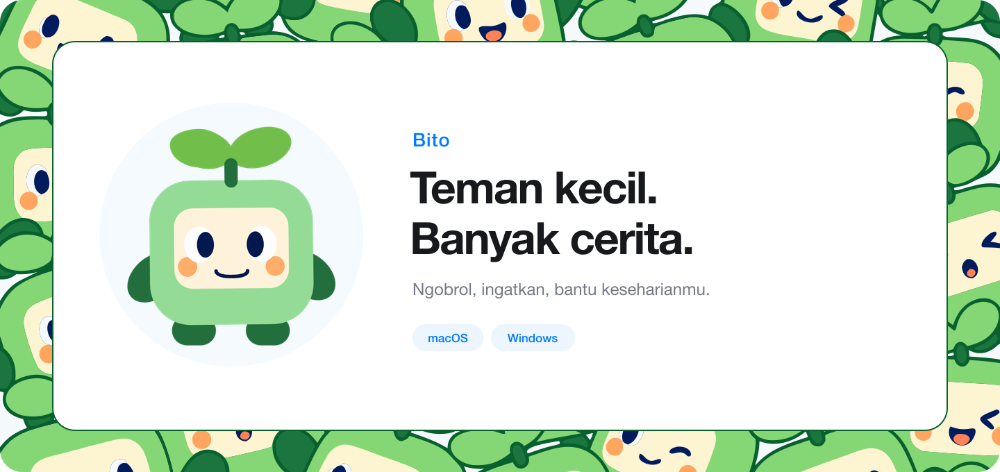

<p align="center">
  
</p>

<h1 align="center">Bito</h1>
<p align="center"><strong>Teman kecil untuk menemani harimu.</strong><br />Tempat ngobrol, teman mikir, dan bantuan kecil—langsung di desktopmu.</p>
<p align="center">
  <a href="https://github.com/feboyfierlyan/bito-desktop/releases/tag/v0.5.0"><strong>Unduh v0.5.0</strong></a> ·
  <a href="#kenalan-dulu">Kenalan dulu</a> ·
  <a href="#mulai-dalam-tiga-langkah">Cara mulai</a> ·
  <a href="CHANGELOG.md">Yang baru</a>
</p>
<p align="center">macOS & Windows · Demo privat · Dibuat dengan karakter dan perhatian</p>

## Kenalan dulu

Bito tinggal di desktopmu. Geser ke tempat yang nyaman, klik saat ingin ngobrol, lalu lanjutkan harimu. Mau cerita random, mikir bareng, atau minta diingatkan sesuatu? Mulai dari chat yang sederhana.

### Ngobrol dengan caramu

Pilih **To the point**, **Chill**, **Humoris**, atau **Care**. Bito menyesuaikan nada percakapannya, dengan bubble berurutan dan jeda mengetik. Bisa singkat, bisa serius, bisa ikut bercanda—sesuai obrolanmu.

### Bantuan yang bisa kamu pakai

- **Pengingat & timer.** “Ingatkan aku minum 10 menit lagi.” Bito mengingatkan lewat bubble di desktop.
- **Checklist.** Pecah rencana jadi langkah yang bisa kamu centang, langsung dari chat.
- **File sederhana.** Minta Bito membuat TXT, Markdown, CSV, atau satu folder; kamu memilih tempat menyimpannya.
- **Catatan yang kamu izinkan.** Minta Bito mengingat hal penting, lalu kelola memorinya di Settings.

### Hadir tanpa memenuhi layar

Karakter bisa kamu seret, chat bisa diubah ukurannya, dan panel menyesuaikan sisi layar. Bito menyapa saat ada pengingat atau balasan yang siap; **Jangan Ganggu** tersedia ketika kamu butuh ruang.

## Mulai dalam tiga langkah

1. **Masuk dengan Google.** Gunakan akun yang sudah mendapat akses demo; kamu tidak perlu menyiapkan API key.
2. **Kenalan sebentar.** Beri tahu nama panggilan dan pilih gaya ngobrolmu.
3. **Bawa Bito ke desktop.** Tahan dan seret karakter keluar jendela perkenalan. Setelah itu, klik untuk ngobrol, seret untuk pindah, atau klik kanan untuk pilihan lainnya.

Sudah pernah kenalan? Bito melanjutkan data lokal akunmu. Kamu bisa mengulang perkenalan lewat Settings.

## Bawa Bito ke desktopmu

**[Download terbaru — v0.5.0](https://github.com/feboyfierlyan/bito-desktop/releases/tag/v0.5.0)**

- **Mac dengan chip Apple** — [Unduh DMG](https://github.com/feboyfierlyan/bito-desktop/releases/download/v0.5.0/Bito-0.5.0-macOS-arm64.dmg) · M1 atau lebih baru.
- **Mac dengan prosesor Intel** — [Unduh DMG](https://github.com/feboyfierlyan/bito-desktop/releases/download/v0.5.0/Bito-0.5.0-macOS-x64.dmg).
- **Windows 64-bit** — [Unduh installer](https://github.com/feboyfierlyan/bito-desktop/releases/download/v0.5.0/Bito-0.5.0-Windows-x64-Setup.exe).

Paket ZIP untuk Mac juga tersedia di halaman rilis. Repo dan demo masih privat: unduhan memerlukan akses GitHub, sedangkan login aplikasi memerlukan akun demo yang diizinkan. Installer belum ditandatangani/notariskan; [panduan instalasi](docs/INSTALL.md) menjelaskan cara membukanya.

[Semua versi](https://github.com/feboyfierlyan/bito-desktop/releases) · [Catatan v0.5.0](docs/releases/v0.5.0.md)

## Kamu tetap punya kendali

Profil, riwayat chat, tugas, dan pengingat disimpan di perangkat, terpisah per akun. Konteks percakapan dikirim ke layanan AI saat kamu mengirim pesan. Key layanan dikelola pemilik demo, bukan dimasukkan oleh setiap pengguna. Kamu bisa menghapus chat, mengelola memori, dan mengekspor data lewat Settings.

Bito tidak mengendalikan aplikasi lain atau membaca semua file di laptopmu. Pengingat bekerja saat aplikasi berjalan. Konversi PDF/Office, kalender, pencarian web, dan suara belum tersedia di versi ini.

## Dibuat untuk tumbuh bersama pemakainya

Bito adalah proyek kuliah yang mengeksplorasi companion desktop untuk motivasi, fokus, dan dukungan keseharian. **v0.5.0** adalah checkpoint untuk dicoba kelompok kecil, dengan ruang untuk memperbaiki perilaku dan percakapan lewat pengalaman nyata.

<details>
<summary><strong>Ingin menjalankan atau mengembangkan Bito?</strong></summary>

Gunakan Node.js 24 atau lebih baru, lalu jalankan dari folder repo:

```sh
npm ci
npm run dev
```

[Panduan pengembang & backend](docs/DEVELOPMENT.md) · [Arsitektur](docs/ARCHITECTURE.md) · [Pengujian](docs/TESTING.md) · [Build & rilis](docs/RELEASING.md)

</details>

<p align="center"><sub>Karakter, artwork, dan animasi Bito merupakan bagian dari proyek tim. Belum tersedia lisensi distribusi publik.</sub></p>
